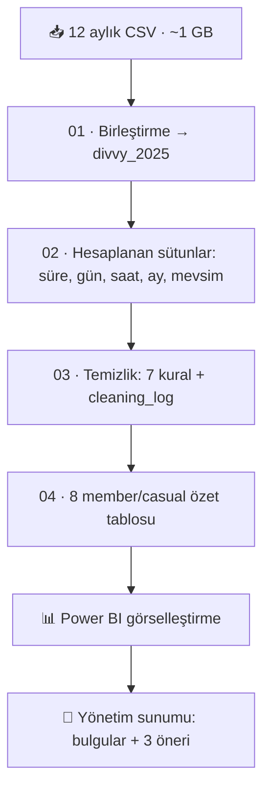

# 🚲 Cyclistic: 5,4 Milyon Sürüşte Üyeler ve Gündelik Kullanıcılar

**Gündelik kullanıcıları yıllık üyeye dönüştürmek için veri odaklı pazarlama analizi**


> Chicago'nun bisiklet paylaşım sistemi Divvy'nin 2025 yılına ait **12 aylık, 5,55 milyon satırlık** sürüş verisini SQL Server'da birleştirdim, temizledim ve özetledim; Power BI ile görselleştirip yönetim ekibine sunulacak bir karar sunumuna dönüştürdüm.

📊 **[Sunumu PDF olarak görüntüle](sunum/Cyclistic_Uye_ve_Gundelik_Kullanici_Analizi.pdf)** · 🗂️ **[SQL betikleri](sql/)**

---

## 📌 Özet

| | Casual (gündelik) | Member (yıllık üye) |
|---|:---:|:---:|
| Sürüş payı | **%35,5** (1,92 M) | %64,5 (3,48 M) |
| Medyan sürüş süresi | **11,9 dk** | 8,7 dk |
| 30 dakikayı aşan sürüşler | **%15,6** | %5,5 |
| Hafta sonu payı | **%37** | %23 |
| Yaz aylarının payı | **%47,5** | %36,0 |
| Başladığı istasyona dönen sürüşler | **%8,2** | %2,2 |

**Tek cümleyle:** Member'lar bisikleti işe gidip gelmek için kısa ve düzenli sürüşlerde, casual'lar ise hafta sonu, yaz aylarında ve sahil boyunca daha uzun keyif sürüşlerinde kullanıyor.

---

## 🎯 İş Problemi

Cyclistic, Chicago'da 5.800'den fazla bisiklet ve 600'ü aşkın istasyonla çalışan bir bisiklet paylaşım şirketi (Divvy verisiyle temsil edilen kurgusal bir şirket). Finans ekibine göre yıllık üyeler gündelik kullanıcılardan çok daha kârlı. Pazarlama direktörü, büyümenin anahtarını yeni müşteri bulmakta değil, sistemi zaten kullanan **gündelik kullanıcıları yıllık üyeye dönüştürmekte** görüyor.

Bana verilen soru:

> **Yıllık üyeler ile gündelik kullanıcılar Cyclistic bisikletlerini nasıl farklı kullanıyor?**

Paydaşlar: pazarlama direktörü, pazarlama analitiği ekibi ve önerileri onaylayacak yönetim ekibi.

Proje, Google Data Analytics sertifika programındaki Cyclistic vaka çalışması temel alınarak **Sor → Hazırla → İşle → Analiz Et → Paylaş → Harekete Geç** adımlarıyla yürütüldü.

---

## 🗃️ Veri

| | |
|---|---|
| **Kaynak** | Divvy (Chicago) kamuya açık sürüş verisi, Motivate International Inc. |
| **Kapsam** | Ocak–Aralık 2025, 12 aylık CSV dosyası, toplam ~1 GB |
| **Ham satır** | 5.552.994 sürüş |
| **Sütunlar** | `ride_id`, `rideable_type`, `started_at`, `ended_at`, başlangıç/bitiş istasyonu ve koordinatları, `member_casual` |
| **Gizlilik** | Kişisel bilgi yok; kullanıcı kimliği bulunmadığı için aynı kişinin tekrar eden sürüşleri izlenemiyor |

> Ham CSV dosyaları depoya eklenmedi; lisans, verinin tek başına bir veri seti olarak yeniden yayımlanmasına izin vermiyor.
>
> Veri, Divvy Veri Lisans Sözleşmesi kapsamında analiz amacıyla kullanılmıştır. Bu proje Divvy, Lyft veya Motivate ile bağlantılı değildir; Cyclistic, vaka çalışmasındaki kurgusal şirkettir.

---

## 🛠️ Yöntem



| Adım | Betik | Ne yapıyor? |
|---|---|---|
| 1 | [`01_veri_birlestirme.sql`](sql/01_veri_birlestirme.sql) | 12 aylık tabloyu dinamik SQL ile sabit tipli tek tabloda birleştirir; her ay için satır sayısını doğrular |
| 2 | [`02_hesaplanan_sutunlar.sql`](sql/02_hesaplanan_sutunlar.sql) | Sürüş süresi, haftanın günü, saat, ay ve mevsim sütunlarını ekler |
| 3 | [`03_veri_temizligi.sql`](sql/03_veri_temizligi.sql) | 7 temizlik kuralını uygular, her kuralın sildiği satırı `cleaning_log`'a yazar |
| 4 | [`04_ozet_tablolar.sql`](sql/04_ozet_tablolar.sql) | Gün, saat, ay, süre aralığı, bisiklet tipi, istasyon ve gidiş-dönüş özetlerini üretir |
| 5 | [`05_powerbi_temizlik_tablosu.sql`](sql/05_powerbi_temizlik_tablosu.sql) | Power BI'daki temizlik tablosunu besleyen sorgu |

**Kullanılan teknikler:** dinamik SQL (`sp_executesql`), `TRY_CONVERT` ile güvenli tip dönüşümü, pencere fonksiyonları (`ROW_NUMBER`, `SUM() OVER`, `PERCENTILE_CONT`), CTE ile tekrar eden kayıt silme, `@@ROWCOUNT` ile temizlik kaydı, harmanlama (collation) farkına dayanıklı metin eşleştirme.

---

## 🧹 Veri Temizliği

| # | Kural | Silinen | Kalan | % |
|:-:|---|--:|--:|--:|
| 1 | `ride_id` / başlangıç / bitiş boş | 0 | 5.552.994 | 0,00 |
| 2 | Geçersiz kullanıcı tipi | 0 | 5.552.994 | 0,00 |
| 3 | Tekrar eden `ride_id` | 0 | 5.552.994 | 0,00 |
| 4 | Süre sıfır veya negatif | 29 | 5.552.965 | 0,00 |
| 5 | **1 dakikadan kısa** (yanlış kilit açma, anında iade) | **146.894** | 5.406.071 | **2,65** |
| 6 | 24 saatten uzun (iade edilmemiş bisiklet) | 5.585 | 5.400.486 | 0,10 |
| 7 | Test / bakım istasyonu | 0 | 5.400.486 | 0,00 |

**Sonuç:** Verinin %2,75'i ayıklandı, analiz **5.400.486 sürüş** üzerinden yapıldı.

> 💡 **Bilinçli karar:** İstasyon adı boş olan sürüşler silinmedi. Bunların çoğu istasyon dışına bırakılabilen elektrikli bisikletler; silinseydi elektrikli bisiklet kullanımı ve onu yoğun kullanan segment olduğundan düşük görünürdü. Bu sürüşler yalnızca istasyon analizinin dışında tutuldu.

---

## 🔍 Bulgular

> Her bulgunun grafiği için 📊 [sunuma](sunum/Cyclistic_Uye_ve_Gundelik_Kullanici_Analizi.pdf) bakabilirsiniz.

### 1. Casual'lar daha az ama daha uzun sürüyor
Casual medyan sürüşü member'lardan **%37 daha uzun** (11,9 dk / 8,7 dk). Medyan, birkaç saatlik uç sürüşlerden etkilenmediği için ana ölçü olarak kullanıldı.

### 2. Uzun sürüşler casual'larda üç kat daha sık
Casual sürüşlerin %15,6'sı 30 dakikayı aşıyor; member'larda bu oran %5,5. Member sürüşlerinin %57'si 10 dakikanın altında kalıyor.

### 3. Casual'lar hafta sonu, member'lar hafta içi
Cumartesi, casual'ların en yoğun günü (%20,7). Member'lar Salı–Perşembe arasında zirve yapıyor.

### 4. Member'ların sabah zirvesi işe gidip gelmeyi gösteriyor
Member'larda sabah 08:00 ve akşam 17:00 olmak üzere iki zirve var. Casual'larda sabah zirvesi yok, ancak akşam 17:00 zirvesi iki segmentte de görülüyor: casual'ların bir kısmı da işten dönerken biniyor.

### 5. Casual kullanımın neredeyse yarısı yazın
Casual sürüşlerin %47,5'i yaz aylarında, yalnızca %4,1'i kışın. Member'lar yıl boyu daha dengeli biniyor.

### 6. Casual'lar sahilden, member'lar iş merkezinden yola çıkıyor
Casual'ların en popüler istasyonları göl kıyısı ve turistik noktalar (Navy Pier, Millennium Park, Shedd Aquarium). Member'larınki Loop ve River North'taki iş bölgeleri.

### 7. Gidiş-dönüş casual'larda ~4 kat fazla; bisiklet tipi ise ayırt edici değil
Casual sürüşlerin %8,2'si başladığı istasyona dönüyor (member'larda %2,2): gezinti amaçlı kullanımın işareti. İki segment de sürüşlerinin yaklaşık üçte ikisini elektrikli bisikletle yapıyor.

---

## 💡 Öneriler

| # | Öneri | Dayandığı bulgu | Başarı ölçütü |
|:-:|---|---|---|
| 1 | **Yaz ve hafta sonuna göre bir giriş paketi:** yaz başında, yıllık üyeliğe dönüşen hafta sonu / sezon paketi | Casual sürüşlerin %47,5'i yazın, %37'si hafta sonunda | Paketten yıllık üyeliğe geçiş oranı |
| 2 | **Uzun sürüşte üyelik avantajını göstermek:** uygulamada sürüş sonrası "üye olsaydın bu sürüş şu kadar tutardı" mesajı | Casual medyan sürüşü %37 daha uzun; %15,6'sı 30 dk+ | Mesajı gören casual'ların dönüşüm oranı |
| 3 | **Sahil istasyonlarında, ilkbaharda dijital kampanya:** istasyonlarda QR kod, konum bazlı reklam, Nisan–Haziran sosyal medya | En popüler casual istasyonları sahilde; kullanım Nisan'dan itibaren artıyor | İstasyon bazında üyelik kaydı |

---

## ⚠️ Sınırlamalar ve Sonraki Adımlar

**Sınırlamalar**
- Kullanıcı kimliği yok: aynı casual'ın kaç kez sürdüğü ve şehirde yaşayıp yaşamadığı bilinmiyor.
- Fiyat ve gelir verisi yok: üyelikle sağlanacak tasarruf ve kârlılık hesaplanamıyor.
- Tek yıllık (2025) veri; hava durumu etkisi ayrıca incelenmedi.
- Turistik istasyonlardaki casual'ların bir kısmı şehir dışından olabilir ve üyeliğe uygun olmayabilir.

**Sonraki adımlar**
- Fiyat verisiyle "üyelik ne zaman kazandırır?" eşiğini hesaplamak.
- Casual kullanıcılara kısa bir anketle üye olmama nedenlerini öğrenmek.
- Önerileri A/B testi ile denemek ve dönüşüm oranını ölçmek.
- Hava durumu verisini ekleyerek mevsim etkisini netleştirmek.

---

## 📁 Depo Yapısı

```
cyclistic-bisiklet-analizi/
├── README.md
├── sql/
│   ├── 01_veri_birlestirme.sql
│   ├── 02_hesaplanan_sutunlar.sql
│   ├── 03_veri_temizligi.sql
│   ├── 04_ozet_tablolar.sql
│   └── 05_powerbi_temizlik_tablosu.sql
└── sunum/
    ├── Cyclistic_Uye_ve_Gundelik_Kullanici_Analizi.pdf
    └── Cyclistic_Uye_ve_Gundelik_Kullanici_Analizi.pptx
```

## ▶️ Nasıl Çalıştırılır?

1. Divvy'nin 2025 yılına ait 12 aylık sürüş verisini (`202501`–`202512`, toplam ~1 GB) edinin.
2. SQL Server Management Studio'da her CSV'yi *Import Flat File* ile ayrı bir tabloya aktarın (ör. `202501-divvy-tripdata-ocak`).
3. `sql/` klasöründeki betikleri sırayla çalıştırın (01 → 04).
4. Power BI Desktop'ta *Veri Al → SQL Server* ile `ozet_` tablolarına ve `05` sorgusuna bağlanın.

---

## 🌍 English Summary

**Cyclistic Bike-Share: How do annual members and casual riders use bikes differently?**
I combined, cleaned and summarised **5.4 million** Divvy (Chicago) rides from 2025 in **SQL Server (T-SQL)** and visualised them in **Power BI**. Casual riders take 35.5% of rides but ride longer (median 11.9 vs 8.7 min), ride more on weekends (37% vs 23%) and in summer (47.5% vs 36%), start from lakefront and tourist stations, and return to their starting station almost 4× as often. Members show a clear commuting pattern with peaks at 8 AM and 5 PM. Recommendations: a summer/weekend entry membership, in-app "what you would have paid as a member" messages after long rides, and geo-targeted spring campaigns at lakefront stations.

---

**Oğuzhan Aydoğdu** · Yönetim ve Bilişim Sistemleri · Veri Analitiği & BI
[GitHub](https://github.com/Oguzhanaydogduu)
